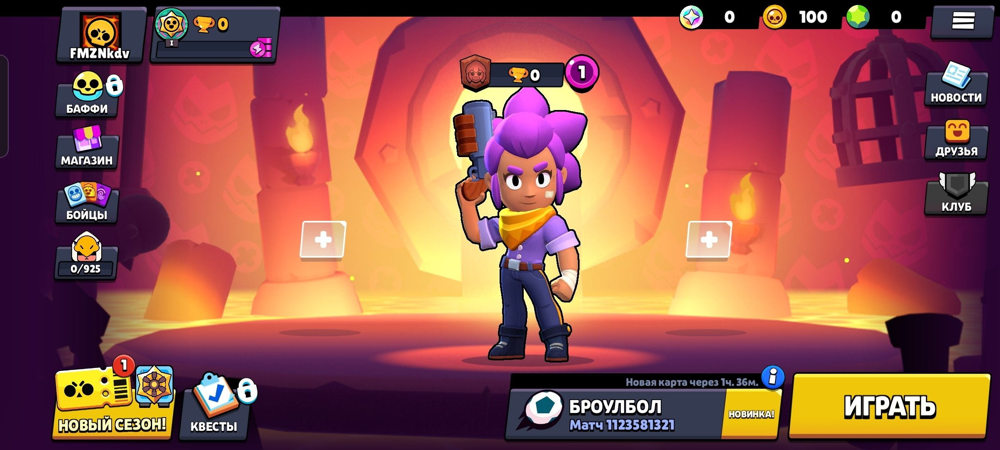

This is the Brawl Stars Core, version 67.264.1, written in Zig.

## Requirements

- Zig (0.18.0)
- Windows\Linux (tested only on x86)
- Brain..? 🧑🏿‍🦯

## Building

```bash
git clone https://github.com/FMZNkdv/BSFv67.git
cd BSFv67
```

## Running

```bash
zig run Server.zig
```

The server will start listening on `0.0.0.0:9339` by default.
